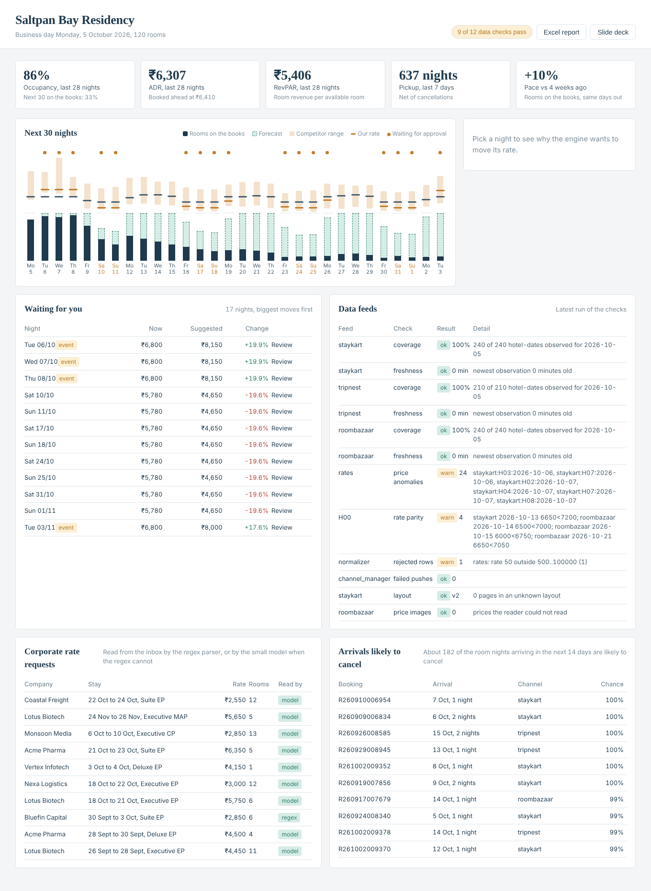
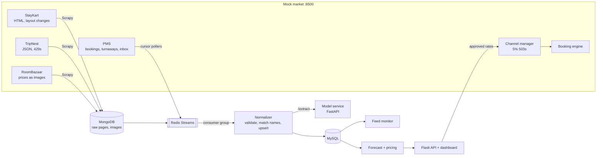

# Occupancy

Rate intelligence for one hotel: crawl what the competition charges, pull bookings from the PMS, check that every feed is healthy, forecast demand for the next 30 nights, recommend a rate for each, and push the approved ones to the channel manager. A revenue manager works from one dashboard and gets a weekly Excel report and slide deck.

**Everything runs against a simulated market.** The hotels, booking sites, PMS and channel manager in `occupancy/market` and `occupancy/ota` are mocks written for this project, so the system can be measured against things a real hotel never sees, like the true demand on a night that sold out. Real OTAs were not scraped. The only outside data is the public Hotel Booking Demand dataset, used to train the cancellation model. All numbers below are measured, and all of them come from the simulator except the cancellation scores.



## What it does



| Part | Where | What it does |
|---|---|---|
| Rate shopping | `occupancy/crawl` | Three Scrapy spiders, one per OTA. Reads both StayKart layouts and counts pages in neither, backs off on TripNest 429s, follows pagination, reads RoomBazaar's price images with an SVM. Every raw page goes to MongoDB first. |
| PMS and feeds | `occupancy/pipeline/ingest.py` | Cursor-based pollers for PMS changes, turnaways, the corporate inbox and the events calendar. They publish to Redis Streams and keep their cursor in MySQL. |
| Normalizer | `occupancy/pipeline/normalize.py` | Redis consumer group. Validates every row, rejects bad ones to a `rejects` table, matches hotel names across OTAs (exact alias, then fuzzy match, which is remembered), and upserts. A replayed old PMS message cannot undo a newer cancellation. Messages are acknowledged after the commit, and abandoned ones are reclaimed. |
| Feed monitor | `occupancy/pipeline/monitor.py` | Coverage and freshness per OTA, price anomalies, rate parity of the hotel's own listings, rejected rows, failed pushes, unknown page layouts, unreadable price images. |
| Forecast | `occupancy/intel/forecast.py` | Additive pickup by weekday and lead time, events averaged separately, turned-away guests counted as demand, sold-out nights treated as censored. |
| Pricing | `occupancy/intel/pricing.py` | Expected revenue over a rate grid, then guardrails (floor, ceiling, at most 20% per day). Every rule that fires is kept as a reason. |
| Explanations | `occupancy/intel/explain.py` | A template sentence from the reasons, or an LLM's sentence if every number in it checks out against the facts. |
| Channel push | `occupancy/intel/engine.py` | Idempotency key per recommendation, retries with backoff, then a read-back from the booking engine. |
| Inbox reader | `occupancy/ml/slm.py` | A 0.65M-parameter character-level transformer trained from scratch that turns rate request emails into fields. It reads the messages a regex parser cannot. |
| Competitive set | `occupancy/ml/compset.py` | Hotel vectors (stars, size, distance, reviews, amenities, TF-IDF of the description) and cosine search. |
| Cancellation risk | `occupancy/ml/cancellation.py` | Logistic regression, decision tree, linear SVM and gradient boosting on the public Hotel Booking Demand data, split by time. |
| Reports | `occupancy/reports` | Weekly `.xlsx` (summary, 30-night calendar with a chart, requests) and a 5-slide `.pptx`. |
| API and UI | `occupancy/api`, `dashboard/` | Flask API and dashboard; FastAPI model service. Approving a rate needs a bearer token. |

## Results

Hardware: 2 vCPU, no GPU. Seeds and commands are given so every number can be rerun.

### Revenue against fixed rates

`python -m occupancy.intel.evaluate --seeds 7 11 23 42 101`

Two copies of the market with the same seed see the same guests on the same days ([why](docs/decisions.md#common-random-numbers-for-the-revenue-comparison)). One keeps the hotel's fixed rates (₹6,800 on weekdays, 85% of that at weekends). The other lets the engine set every rate each morning, all recommendations applied. 12 weeks, after a 120-day warm-up; revenue counted for the stay dates priced entirely by each policy.

| Seed | Fixed RevPAR | Engine RevPAR | Change | Occupancy fixed → engine | ADR fixed → engine |
|---|---|---|---|---|---|
| 7 | ₹5,578 | ₹5,921 | +6.2% | 89.0% → 98.8% | ₹6,268 → ₹5,993 |
| 11 | ₹5,635 | ₹5,865 | +4.1% | 89.7% → 97.2% | ₹6,279 → ₹6,033 |
| 23 | ₹5,444 | ₹5,846 | +7.4% | 86.7% → 96.5% | ₹6,280 → ₹6,060 |
| 42 | ₹5,633 | ₹5,920 | +5.1% | 89.8% → 97.3% | ₹6,270 → ₹6,086 |
| 101 | ₹5,426 | ₹5,700 | +5.0% | 86.3% → 96.4% | ₹6,286 → ₹5,912 |

The engine wins in all five, by filling rooms the fixed rates left empty on slow nights; its average rate is lower. The policy assumes price elasticity 2.0; the simulated guests have 2.6. This shows the method works on this simulator, not what it would earn for a real hotel.

### Forecast error

`python -m occupancy.intel.evaluate --backtest --seeds 7 11 23`

Mean absolute error in rooms (120-room hotel), every morning for 56 days, against two baselines: rooms already on the books, and the final count of the most recent same-weekday night.

| Days out | Pickup forecast | On the books | Same weekday last time |
|---|---|---|---|
| 1 | 1.2 – 1.5 | 9.7 – 10.0 | 4.0 – 5.9 |
| 3 | 1.7 – 2.6 | 21.2 – 24.1 | 4.0 – 5.4 |
| 7 | 3.0 – 3.7 | 44.6 – 48.2 | 4.8 – 6.3 |
| 14 | 6.8 – 7.7 | 78.3 – 79.2 | 6.6 – 8.8 |
| 30 | 12.4 – 14.7 | 98.1 – 101.3 | 10.9 – 13.9 |

Ranges are across the three seeds. The pickup forecast beats both baselines up to 7 days out. At 14 and 30 days the same-weekday baseline is as good or better. Between 56% and 57% of these nights sold out, and a sold-out night is easy to forecast once the forecast is capped at 120, so these errors are lower than they would be for a hotel that rarely fills.

### Reading prices from images

`python -m occupancy.ml.price_reader`

Whole-price exact match on 500 fresh renders each (noise, blur, rotation, jitter). The held-out font is never seen in training.

| Model | Training fonts | Held-out font |
|---|---|---|
| kNN (k=3), baseline | 0.978 | 0.982 |
| SVM (RBF) | 0.990 | 0.990 |

In the end-to-end run below, one RoomBazaar price was misread as ₹50; the normalizer's range check rejected it and the feed monitor reported it.

### Reading rate request emails

`python -m occupancy.ml.slm eval`

Whole-record exact match (all seven fields right) on 300 messages per set. The model never sees the two held-out templates in training. "With typos" mistypes 4% of letters (dropped, doubled or swapped), the rate the mock inbox uses.

| Set | Regex parser | SLM | Regex, then SLM if regex fails |
|---|---|---|---|
| Training templates | 0.983 | 1.000 | 1.000 |
| Held-out templates | 0.947 | 0.687 | 0.963 |
| Held-out templates, with typos | 0.253 | 0.720 | 0.760 |

The regex parser was written against the templates, so it is near perfect on clean text and falls apart on typos. On clean held-out messages, every record it returned was right (284 of 284). The model is the reverse: it shrugs off typos but gets the company name (0.83) and meal plan (0.86) wrong more often on phrasings it has not seen. The normalizer therefore runs the regex first and sends only what it cannot parse to the model. The model has 653,632 parameters, trained for 5,000 steps (67 minutes on 2 vCPUs that were also running other jobs; no GPU), and takes about 165 ms per message on the same machine.

A first version trained on the six templates alone scored 0.04 on the held-out templates. The current one also trains on messages composed from loose clauses in random order, for 5,000 steps instead of 2,000, and decodes under the field schema; together those moved it to 0.69. Their separate effects were not measured.

### Cancellation risk

`python -m occupancy.ml.cancellation` (public data; trained on arrivals before 2017, tested on 40,687 arrivals in 2017, 38.7% cancelled)

| Model | Accuracy | ROC AUC |
|---|---|---|
| Always "not cancelled" | 0.613 | |
| Logistic regression | 0.674 | 0.721 |
| Linear SVM | 0.671 | 0.720 |
| Decision tree | 0.705 | 0.747 |
| Gradient boosting (shipped) | 0.699 | 0.757 |

The deposit-type column is left out on purpose; with it AUC was 0.805 but the model ranked non-refundable bookings as the most likely to cancel ([why](docs/decisions.md#cancellation-model-without-the-deposit-type)). In the public data 99.4% of the 14,587 non-refundable bookings and 91.6% of bookings by guests with an earlier cancellation were cancelled. The second pattern is kept, which is why the top of the dashboard's list sits near 100%. The model is trained on Portuguese hotels and scores simulated Indian bookings, so its ranking on the dashboard is a demonstration of the wiring, not a validated score for this hotel.

### End to end

Seven business days of `python -m occupancy.cycle --advance --auto-within 0.08` against the mock market, after a 120-day warm-up:

- Each day's crawl collects 690 prices (240 StayKart, 210 TripNest, 240 RoomBazaar). A full cycle (crawl, ingest, normalize, checks, recommendations, pushes) took 19 to 20 seconds on 2 vCPUs.
- The first cycle loaded the 120-day backlog: 11,801 messages normalized, 39.5 seconds in total.
- StayKart switched to its new layout on the sixth day. The spider read it, coverage stayed at 240 of 240, and the renamed listing "Hotel Creekside Inn, Vashi" was matched to the right hotel by fuzzy match and remembered.
- On the last day the monitor flagged 4 rate parity breaks on the hotel's own OTA listings and 24 prices more than 35% away from the median the same hotel had charged at the same lead time over the previous 8 days.
- The inbox held 41 rate requests. The regex parsed 11 and the model read the other 30. Checked against the simulator's answers, 36 of 41 records were fully right (all 11 regex, 25 of 30 model).
- Recommendations within 8% of the current rate were approved automatically: 59 were pushed over the six advancing days, 0 failed, and every one read back correctly from the booking engine, with the channel manager failing 5% of calls.

## Run it locally

Needs Python 3.11+, MySQL 8, Redis 7 and MongoDB 7 (or `docker compose up -d mysql redis mongo`).

```bash
python -m venv .venv && . .venv/bin/activate
pip install torch --index-url https://download.pytorch.org/whl/cpu
pip install -e ".[dev]"

python -m occupancy.ota.app                                 # mock market on :8500 (120-day warm-up first)
uvicorn occupancy.api.models:app --port 8600               # model service
python -m occupancy.pipeline.normalize                      # normalizer, runs forever
python -m occupancy.cycle --advance                         # one cycle, market one day forward
API_TOKEN=<something> flask --app occupancy.api.app run --port 8000
```

The cycle also drains the Redis streams, so the separate normalizer is optional for a quick run. Without MongoDB, set `MONGO_URL=mongomock://occupancy`: the in-memory store lives inside one process, so the cycle then runs the crawl in its own process and can only run once per process (no `--every`).

Or the whole stack: `cp .env.example .env`, edit it, `docker compose up -d --build`. The dashboard is on http://127.0.0.1:8000. Deployment behind Caddy on EC2: [docs/deploy.md](docs/deploy.md).

The three trained models are in `models/` (about 8 MB), so nothing needs training to run. To retrain: `scripts/train_models.sh` (downloads the public dataset and checks its SHA-256).

## Tests

```bash
pytest -q          # MySQL tests use the occupancy_test database and Redis db 1, and skip if either is down
ruff check occupancy tests
```

38 tests: the simulator (same seed same market, higher price fewer rooms, never oversold), the mock sites (layout change, pagination, 429, signed image URLs, channel manager idempotency), spider parsing on saved pages, the price reader on an unseen font, date handling in extraction, the forecast and guardrails, the LLM number check with a fake server, the normalizer against real MySQL and Redis (replays, an old message after a cancellation, fuzzy names, rejects, reclaiming unacknowledged messages), and the approval API (token, single push, out-of-range override).

## What is not done

- MongoDB was only exercised through mongomock; no MongoDB server was available while building.
- The Docker image and compose file have not been built.
- The LLM path is tested against a fake server, not a real provider.
- One shared token instead of user accounts.
- More in [docs/decisions.md](docs/decisions.md).
